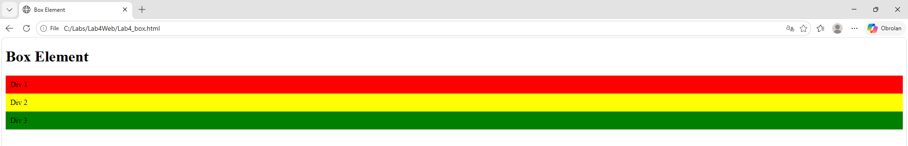
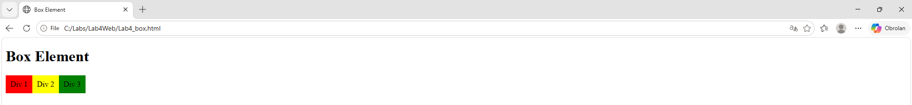
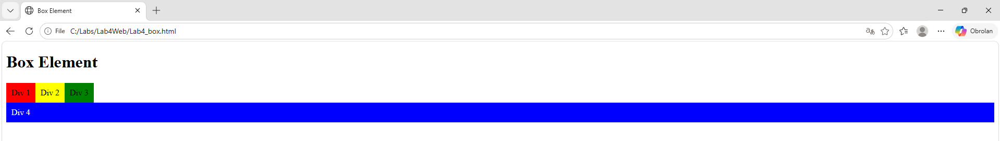
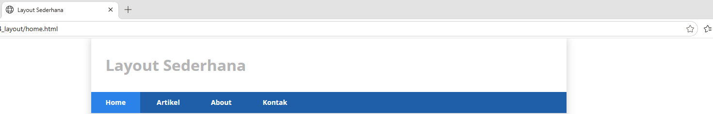
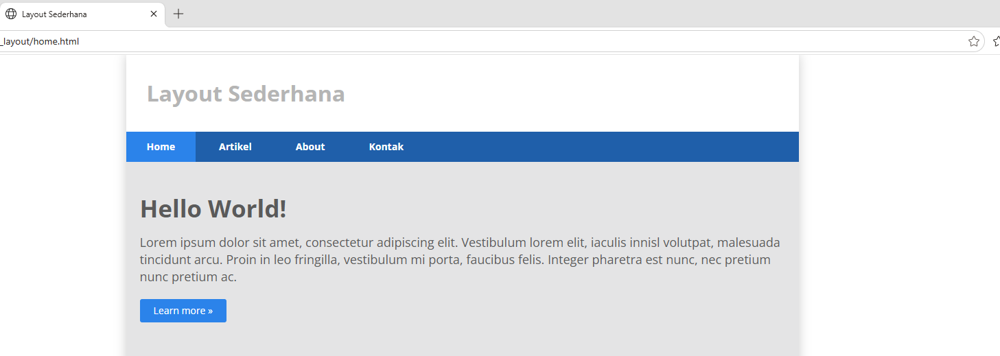
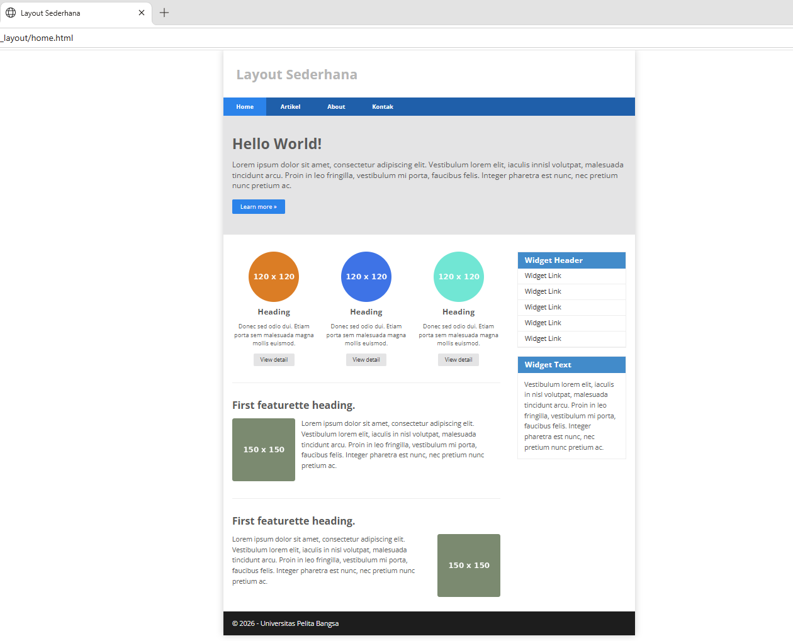
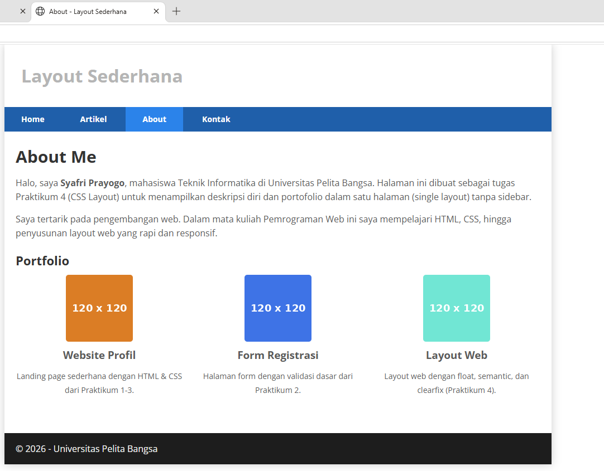
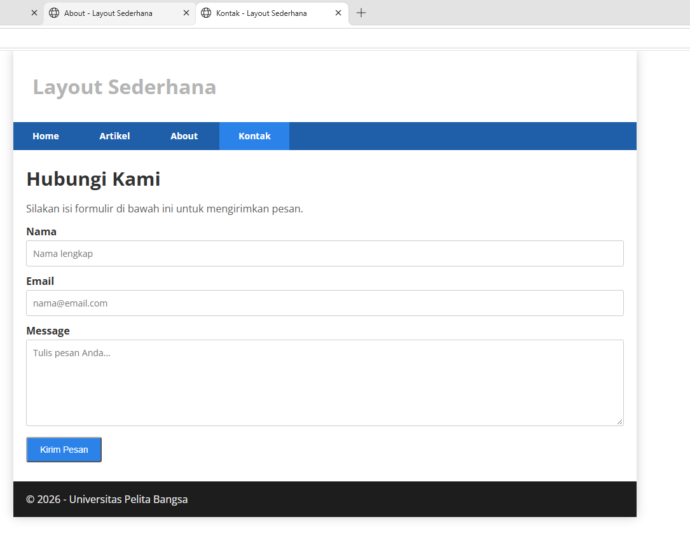

# Laporan Praktikum 4 — CSS Layout

**Mata Kuliah:** Pemrograman Web <br>
**Dosen Pengampu:** Agung Nugroho <br>
**Universitas Pelita Bangsa** — Fakultas Teknik — Teknik Informatika

| Keterangan | Isi |
|---|---|
| Nama | Syafri Prayogo |
| NIM | 312510500 |
| Kelas | TI.25.C.3 |
| Program Studi | Teknik Informatika |

---

## 1. Tujuan Praktikum

1. Mahasiswa mampu memahami struktur dasar pembuatan Layout.
2. Mahasiswa mampu memahami konsep box element.
3. Mahasiswa mampu memahami CSS Floating.
4. Mahasiswa mampu memahami HTML5 Semantics Element.
5. Mahasiswa mampu membuat Layout Web Sederhana.

## 2. Dasar Teori

**Web Layout** adalah kerangka yang mengatur penempatan tata letak elemen pada halaman web (navigasi, header, tombol CTA, dan lainnya). Halaman web sering dibagi menjadi header, menu, konten, dan footer.

**Box Element** — setiap elemen HTML dapat dianggap sebagai box (kotak). Konsep box element terdiri dari **Margin, Border, Padding, dan Content**. Tag yang biasa dipakai merancang layout adalah `<div>`.

**CSS Float Property** memungkinkan elemen HTML seolah-olah mengambang di antara elemen lain, sehingga mudah menentukan posisi/letak elemen. Properti yang dipakai: `float` dan `clear`. **Clearfix** (property `clear`) dipakai untuk mengatur elemen setelah float element.

**HTML5 Semantics Element** — elemen bermakna yang mendefinisikan bagian halaman:

| Tag | Keterangan |
|---|---|
| `<header>` | Header untuk dokumen atau bagian |
| `<nav>` | Satu set link navigasi |
| `<section>` | Bagian dalam dokumen |
| `<article>` | Konten artikel |
| `<aside>` | Konten selain konten utama (sidebar) |
| `<footer>` | Footer untuk dokumen atau bagian |
| `<details>` / `<summary>` | Detail tambahan yang dapat dibuka/ditutup |

## 3. Alat dan Bahan

| Alat / Bahan | Keterangan |
|---|---|
| Text Editor | Visual Studio Code |
| Web Browser | Google Chrome / Mozilla Firefox |
| Version Control | Git dan GitHub (repository `Lab4Web`) |

---

## 4. Langkah-langkah Praktikum

### 4.1 Box Element tanpa Float

Buat file `lab4_box.html`, lalu buat box dengan tag `<div>` (class div1/div2/div3). Tanpa float, setiap div tampil menurun (block, satu per baris).

```html
<section>
    <div class="div1">Div 1</div>
    <div class="div2">Div 2</div>
    <div class="div3">Div 3</div>
</section>
```

```css
div { padding: 10px; }
.div1 { background: red; }
.div2 { background: yellow; }
.div3 { background: green; }
```



> *Gambar 4.1 — Tiga div tanpa float tampil bertumpuk ke bawah (default block).*

### 4.2 Box Element dengan Float

Tambahkan `float: left;` pada selector `div` agar ketiga box tampil berjajar ke samping.

```css
div {
    float: left;
    padding: 10px;
}
```



> *Gambar 4.2 — Dengan float: left, ketiga div berjajar horizontal.*

### 4.3 Mengatur Clearfix

Tambahkan `<div class="div4">` setelah div3, lalu atur property `clear` agar div4 turun ke bawah (tidak ikut mengambang).

```html
<div class="div4">Div 4</div>
```

```css
.div4 {
    background-color: blue;
    clear: left;
    float: none;
}
```



> *Gambar 4.3 — Clearfix: div4 (biru) turun ke bawah karena clear: left, memutus efek float.*

### 4.4 Membuat Layout — Header & Navigasi

Buat folder `lab4_layout` berisi `home.html` dan `style.css`. Susun kerangka semantic (`#container`, `header`, `nav`, `#hero`, `#wrapper` berisi `#main` + `#sidebar`, `footer`), import Google Font, reset CSS, lalu beri style pada container (lebar 980px, center), header, dan navigasi.

```css
#container { width: 980px; margin: 0 auto; box-shadow: 0 0 1em #cccccc; }
nav { display: block; background-color: #1f5faa; }
nav a { padding: 15px 30px; display: inline-block; color: #fff;
        text-decoration: none; font-weight: bold; }
nav a.active, nav a:hover { background-color: #2b83ea; }
```



> *Gambar 4.4 — Header dan menu navigasi (item aktif/hover berwarna lebih terang).*

### 4.5 Membuat Hero Panel

Tambahkan `<section id="hero">` berisi judul, paragraf, dan tombol, lalu beri style.

```css
#hero { background-color: #e4e4e5; padding: 50px 20px; margin-bottom: 20px; }
#hero h1 { margin-bottom: 20px; font-size: 35px; }
#hero p { margin-bottom: 20px; font-size: 18px; line-height: 25px; }
```



> *Gambar 4.5 — Hero panel: judul besar, paragraf, dan tombol "Learn more".*

### 4.6 Main, Sidebar, Widget, Content & Footer

Atur `#main` (float left, width 640px) dan `#sidebar` (float left, width 260px). Sidebar diisi `.widget-box` (Widget Header berisi list link + Widget Text). Main content diisi 3 kolom `.box` (`.row` dengan clearfix, `img.image-circle`), lalu artikel `.entry` dengan `.divider` dan gambar float kiri/kanan (`.right-img`). Footer memakai `clear: both`.

```css
#main { float: left; width: 640px; padding: 20px; }
#sidebar { float: left; width: 260px; padding: 20px; }
.box { float: left; width: 33.333333%; box-sizing: border-box; text-align: center; }
.image-circle { border-radius: 50%; }
.row:after { content: ''; display: table; clear: both; }
.entry img { float: left; border-radius: 5px; margin-right: 15px; }
.entry .right-img { float: right; margin-left: 15px; margin-right: 0; }
footer { clear: both; background-color: #1d1d1d; padding: 20px; color: #eee; }
```



> *Gambar 4.6 — Tampilan akhir `home.html`: hero, 3 box kolom, sidebar widget, artikel featurette, dan footer.*

---

## 5. Pertanyaan dan Tugas

### Tugas 1 — Layout untuk menu About (single layout: deskripsi & portfolio)

Halaman `about.html` memakai `header`, `nav`, dan `footer` yang sama, tetapi konten berupa single layout (tanpa sidebar) berisi deskripsi diri dan bagian portfolio (3 box).



> *Gambar 5.1 — Halaman About: deskripsi diri dan portfolio.*

### Tugas 2 — Layout untuk menu Contact (form isian)

Halaman `kontak.html` berisi form dengan isian **Nama**, **Email**, dan **Message**, lengkap dengan tombol kirim.

```html
<form>
    <div class="form-group">
        <label for="nama">Nama</label>
        <input type="text" id="nama" name="nama" required>
    </div>
    <div class="form-group">
        <label for="email">Email</label>
        <input type="email" id="email" name="email" required>
    </div>
    <div class="form-group">
        <label for="message">Message</label>
        <textarea id="message" name="message" rows="6" required></textarea>
    </div>
    <button type="submit" class="btn btn-large">Kirim Pesan</button>
</form>
```



> *Gambar 5.2 — Halaman Contact: form Nama, Email, dan Message.*

---

## 6. Struktur Output Repository

```
Lab4Web/
├── lab4_box.html             # box element, float, clearfix (CSS internal)
├── lab4_layout/
│   ├── home.html             # layout utama (hero, main, sidebar, artikel, footer)
│   ├── about.html            # Tugas 1 — deskripsi & portfolio
│   ├── kontak.html           # Tugas 2 — form kontak
│   ├── style.css             # seluruh CSS layout
│   └── img/                  # gambar placeholder (pic1-3, feat1-2)
├── screenshots/              # hasil screenshot tiap tahap
└── README.md                 # laporan / dokumentasi praktikum
```

## 7. Kesimpulan

Melalui Praktikum 4 ini telah dipahami cara menyusun **layout web** dengan konsep **box element** (margin, border, padding, content), penggunaan **CSS float** untuk menata elemen berdampingan, dan **clearfix** (`clear`) untuk memutus efek float. Telah diterapkan pula **HTML5 semantic element** (`header`, `nav`, `section`, `article`, `aside`, `footer`) untuk menyusun kerangka halaman yang bermakna.

Hasil akhir berupa layout web sederhana lengkap (header, navigasi, hero panel, main content tiga kolom, sidebar widget, artikel, dan footer), serta dua halaman tugas — **About** (single layout deskripsi & portfolio) dan **Contact** (form isian nama, email, message). Seluruh tahap diuji pada browser dan struktur HTML sudah valid (tag seimbang).

> Catatan: gambar pada layout memakai file lokal di folder `img/` (placeholder) sebagai pengganti layanan `dummyimage.com` agar repository bersifat self-contained dan tetap tampil tanpa koneksi internet.
